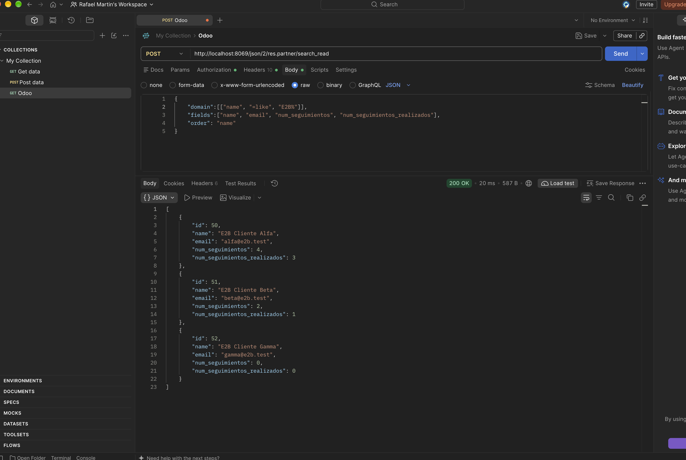

# Simualción mediante API 

**Entorno:** local  ·  **base:** mf1215.  ·  **Odoo:** 19 Community ·  **Herramienta:** Postman

## 1. API utilizada 
(JSON-2: URL, autenticación, formato del cuerpo y de la respuesta)

## 2. La petición 
```http
POST http://localhost:8069/json/2/res.partner/search_read
Authorization: Barrer <clave API>
X-Odoo-Database: mf1215
Content-type: application/json

{
    "domain":[["name", "=like", "E2B%"]],
    "fields":["name", "email", "num_seguimientos", "num_seguimientos_realizados"],
    "order": "name"
}

```

## 3. Respuesta 

```json
[
    {
        "id": 50,
        "name": "E2B Cliente Alfa",
        "email": "alfa@e2b.test",
        "num_seguimientos": 4,
        "num_seguimientos_realizados": 3
    },
    {
        "id": 51,
        "name": "E2B Cliente Beta",
        "email": "beta@e2b.test",
        "num_seguimientos": 2,
        "num_seguimientos_realizados": 1
    },
    {
        "id": 52,
        "name": "E2B Cliente Gamma",
        "email": "gamma@e2b.test",
        "num_seguimientos": 0,
        "num_seguimientos_realizados": 0
    }
]
```


**Comprobación:** Alfa 4/3 · Beta 2/1 · Gamma 0/0 --> coincide con los datos de control

## 4. Prueba de seguridad
Clave falsa -> 401 <<invalid apikey>>

## 5. Mensaje para el sistema destino
```json
{
    "cabecera": {
        "origen": "odoo19/mf1215",
        "tipo_transaccion": "sincronizacion_lote",
        "operacion": "upsert",
        "generado_UTC": "2026-11-17T19:02:00Z",
        "version_esquema": "1.0",
        "num_registros": 3
    },
    "clientes": [
        {
            "ref_externa": "mf1215.res_partner.50",
            "nombre": "E2B Cliente Alfa",
            "email": "alfa@e2b.test",
            "seguimientos": {"total": 4, "realizados": 3, "pendientes": 1},
            "detalle": [
                {"id": 1, "asunto": "S1 · Llamada de presentación", "fecha": "2026-11-17", "estado": "realizado"},
                .
                .
                .
            ]
        },
        {
            "ref_externa": "mf1215.res_partner.51",
            "nombre": "E2B Cliente Beta",
            "email": "beta@e2b.test",
            .
            .
            .
            .
        }

        {
            .
            .
            .
            .
            .
            "detalle": []
        }
    ]
}

```

## 6 Traspaso de datos ERP ↔ CRM

Dentro de Odoo no hace falta traspasar datos, porque todas las aplicaciones usan la misma
base de datos. El traspaso hace falta cuando queremos enviar los datos a **otro programa**
(por ejemplo, un CRM externo).

El proceso tiene 4 pasos:

1. **Sacar los datos (extracción):** pedimos a Odoo los clientes y sus seguimientos con la
   API, desde Postman (`POST /json/2/res.partner/search_read`).
2. **Prepararlos (transformación):** los ponemos en el formato que entiende el otro programa
   (el JSON del apartado 5).
3. **Enviarlos (carga):** mandamos ese JSON al otro programa.
4. **Comprobar (verificación):** miramos que han llegado todos: 3 clientes y 6 seguimientos,
   igual que en Odoo.

Lo enviaríamos **una vez al día, todo junto (por lotes)**, porque el otro programa solo
necesita un resumen diario.

## 7 Mecanismos de entrada automática de datos

Son formas de meter datos en Odoo **sin escribirlos a mano**:

| Mecanismo | Ejemplo |
|---|---|
| **API** | Otro programa crea un seguimiento llamando a `seguimiento.cliente/create` (lo probamos en Postman) |
| **Importar un fichero** | Subimos un CSV o un Excel con muchos seguimientos de golpe (⚙ Acciones › Importar) |
| **Acción automatizada** | Odoo crea o modifica datos solo cuando pasa algo, por ejemplo al recibir un aviso de la web |

Ventaja: hay menos errores, porque nadie copia los datos a mano, y Odoo sigue comprobando sus
reglas (por ejemplo, no deja crear un seguimiento sin cliente).